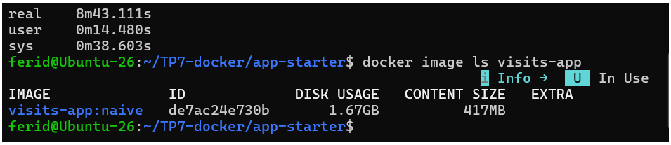
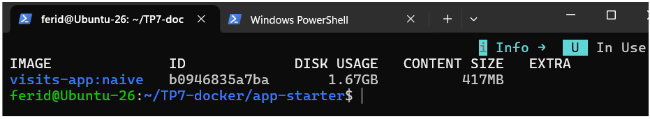
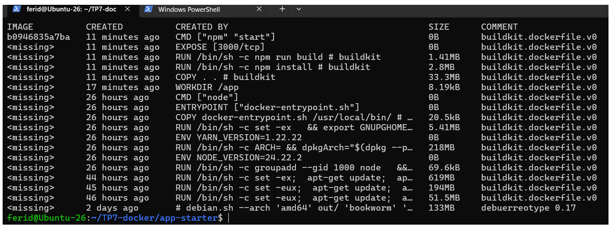
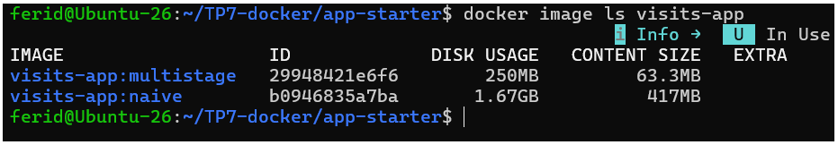
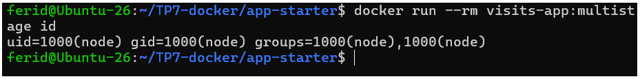

# TP7 : Docker avancé et Docker Compose

**Étudiant :** Ferid Saad
**Formation :** Master DevOps & Cloud, ISET Tozeur
**Environnement :** VM Ubuntu Server 26.04, Docker 29.1.3, Compose v5.6.0, Buildx v0.37.1

## 1. Objectif
Produire une image Docker petite et sûre (multi-stage, non-root, HEALTHCHECK), puis décrire une pile complète (app + PostgreSQL + Adminer) avec Docker Compose, et construire une image multi-architecture avec Buildx.

## 2. Partie 1 : Couches et cache
Build de l'image naïve (`Dockerfile.naive`) puis modification d'une ligne de `src/server.ts` et reconstruction.

- Les étapes `FROM` et `WORKDIR` sont réutilisées du cache.
- `COPY . .`, `npm install` et `npm run build` sont reconstruites.

**Pourquoi `npm install` est-il réexécuté ?** `COPY . .` copie tout le projet avant l'installation des dépendances. Modifier `server.ts` change le contenu de cette couche, donc Docker l'invalide ainsi que toutes les suivantes, y compris `npm install`, même si `package.json` n'a pas changé. Il faut copier d'abord uniquement `package*.json`, lancer `npm ci`, puis copier les sources.

Sans `.dockerignore`, la couche `COPY . .` embarque aussi le `node_modules/` local (33,3 MB).

## 3. Partie 2 : Mesures de l'image naïve
_À compléter._

## 4. Partie 3 : Dockerfile multi-stage

| Indicateur | naive | multistage |
|---|---|---|
| Taille de l'image | 1,67 GB | |
| Temps de build (à froid) | 8 min 43 s | |
| Temps de build (code modifié) | 30 s | |
| Vulnérabilités HIGH/CRITICAL | | |
| Utilisateur | | |

## 5. Partie 4 : Pile Docker Compose
_À compléter : persistance, isolation réseau, effet de `docker compose down -v`, problème du `--scale app=2` avec `ports`._

## 6. Partie 5 : Buildx multi-architecture
_À compléter._

## 7. Défi (optionnel)
_Nginx reverse proxy et secret de build._

